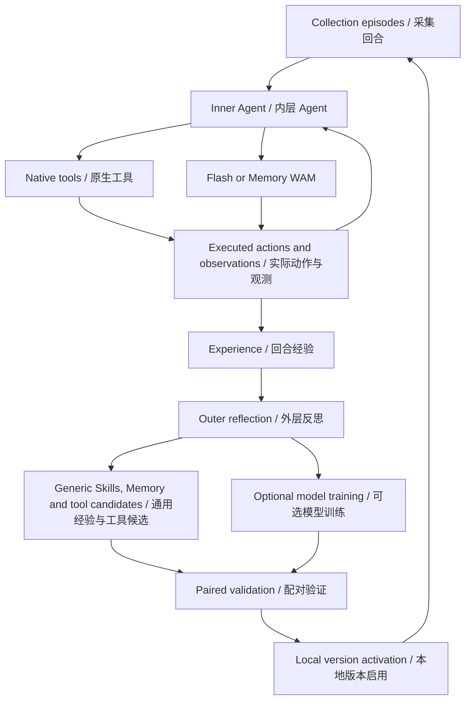

# Architecture / 架构

## Inner Agent / 内层 Agent

`model.py` loads one frozen Harness. The Agent sees the public task instruction, robot observations and the shared generic library. It can call native tools, Flash or Memory according to the observed scene, progress and capability descriptions. WAM receives the original environment instruction.

模型入口加载固定版本的 Harness。Agent 根据公开任务指令、机器人观测和通用经验库，结合当前进展选择原生工具、Flash 或 Memory。传给 WAM 的任务指令来自环境原文。

Only acknowledged actions advance policy history. At an action boundary the Agent can take over; the unexecuted suffix is discarded. Completed chunks retain the checkpoint's rolling state. Switching policies resets the old context. The generic completion guidance includes retracting, returning both arms and restoring the grippers before termination.

Policy 历史随已确认执行的动作推进。Agent 可在动作边界接管，未执行的后缀被丢弃；完整执行的 chunk 保留模型的 rolling 状态，切换策略时清空旧上下文。通用收尾经验包含撤离、双臂归位和夹爪恢复。

## Outer loop / 外层循环

`rsi/local_loop.py` coordinates collection, reflection, candidate construction, validation and activation. `rsi/episode_jobs.py` dispatches each episode to an isolated simulator process. `rsi/worker.py` pins the model version at episode start; a newly activated version is used by subsequent episodes.

外层统一组织采集、反思、候选构建、验证和启用。每个回合由独立仿真进程执行，并在开始时绑定版本；新版本用于后续回合。

Reflection reads collection records, including observations, camera images, actions and tool feedback. Validation records remain separate. Candidates update generic Skills, Memory or permitted tool code. With training configured, the loop can also train a model and start a separate service for its weights.

反思读取采集记录中的观测、相机图像、动作与工具反馈；验证记录单独保存。候选可更新通用 Skill、Memory 或允许修改的工具代码。配置训练后，外层也可训练模型并为新权重启动独立服务。

## Experience and versions / 经验与版本

The episode process stages its trace and cleanup receipt. Its parent records the actual exit and commits the complete experience directory. The registry stores immutable releases, active versions and per-episode bindings. Paired validation compares baseline and candidate on the same official layout identities.

回合进程先暂存轨迹和收尾记录，父进程确认实际退出后提交完整经验目录。注册表保存不可变版本、当前版本和回合绑定。配对验证在相同官方 layout 上比较基线与候选。

Official non-Open layouts drive collection and validation. Model training uses its separately configured training dataset. See [layout selection](OFFICIAL_LAYOUTS.md) and [autonomous RSI](LOCAL_RSI.md).

